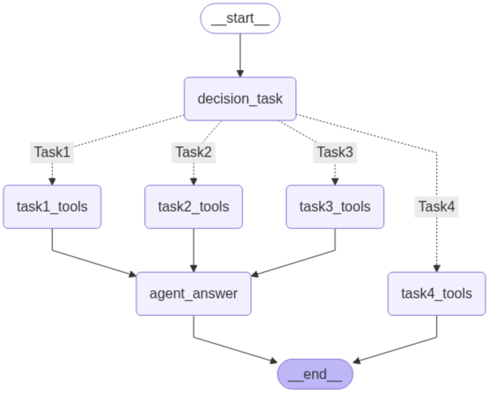

<div align=center>
  
**FIN문철**은 투자대법관으로서 정확한 주식 정보 조회와 <br>
투자 판단 지표를 제공하여 사용자의 투자 의사결정을 지원합니다.

1️⃣ 이정 : TASK5 내용 써줘.....<br>
2️⃣ 이정 :표지 사진 넣어줘....<br>
3️⃣ 하윤 : API 사용법 / 구현 과정 써줘...<br>
</div>

## 🏆 Competition
**제 9회 미래에셋증권 AI Festival**

## 🗓️ Timeline
2025.06.25 ~ 2025.07.31

## 👪 Team
**이하윤** ([hayo0n](https://github.com/hayo0n)) · **김이정** ([shashamalone](https://github.com/shashamalone)) · **윤왕규** ([yoonwanggyu](https://github.com/yoonwanggyu)) 

## 📚 Project Structure

```plaintext
📦 프로젝트 루트
├── 📂 data/
│   └── 📄 krx_tickers_with_market.csv
├── 📂 langgraph/
│   ├── 📄 agent_core.py
│   ├── 📄 nodes.py
│   └── 📄 state.py
├── 📂 tools/
│   ├── 📄 task1_tools.py
│   ├── 📄 task2_tools.py
│   └── 📄 task3_tools.py
├── 📄 .gitignore
├── 📄 Dockerfile
├── 📄 data_fetcher.py
├── 📄 llm.py
├── 📄 main.py
├── 📄 prompt.py
└── 📄 redis_connector.py
└── 📄 utils.py
└── 📄 requirements.txt
```

## ⚙️ Tech Stack Overview
- 🧠 **LLM : HyperClova X**<br>
  네이버의 대규모 언어모델로, 한국어에 특화된 고성능 AI 서비스를 제공합니다.<br>
  → 투자 관련 질의응답, 주식 분석, 금융 데이터 해석 등 전문적인 투자 상담 서비스의 핵심 엔진으로 활용

- 🔄 **LangGraph** <br>
  상태 기반 LLM 프레임워크로, 복잡한 에이전트 워크플로우를 유연하게 설계할 수 있습니다.<br>
  → Agentic RAG 흐름(Task 분기 → Tool 호출 -> 답변 생성)을 구현<br>

- ⚡ **Redis** <br>
  고성능 인메모리 데이터 스토어로, 캐싱과 세션 관리를 담당합니다. <br>
  → yfinance 데이터 (2024.01 ~ 2025.07) 데이터 적재 <br>
  
- 🐳 **Docker** <br>
  컨테이너화를 통한 일관된 개발 및 배포 환경을 제공합니다.<br>
  → 애플리케이션과 Redis를 컨테이너로 구성하여 환경 독립성과 배포 편의성 확보 <br>

## 🗺️ LangGraph Execution Flow
<p align="center">
  
</p>

## 🔄 Flow Details
🎯 **Decision Task**
- 목적: 사용자 질문을 적절한 Task로 분류
- 구현: 프롬프트 엔지니어링을 통한 라우팅<br>

⚙️ **Task Tools**
- 통합: Langchain Tool 데코레이터를 활용하여 HyperClova X와 연동
- 구성: 각 Task 특성에 맞는 전용 도구 세트<br>
  Task 1: 8개 도구<br>
  Task 2: 1개 도구<br>
  Task 3: 5개 도구<br>
- 동작: HyperClova X가 사용자 질문을 분석하여 적합한 도구를 자동 선택 및 실행<br>

🔧 **Specialized Technology (Task 5)**

## 🚀 API 사용법
1️⃣ 레포지토리 클론
```bash
git clone 
cd your-repo-name
```
2️⃣ 필수 라이브러리 설치
```bash
pip install -r requirements.txt
```

3️⃣ 환경 변수 설정 (.env 파일 생성)<br>
```bash
# GPT API 설정
OPENAI_API_KEY=''

# Neo4J 설정
NEO4J_URI=''
DATABASE=''
AUTH_LINK=''

# Pinecone 설정
PINECONE_API_KEY=''

# Slack MCP 설정
SLACK_BOT_TOKEN=''
SLACK_TEAM_ID=''
```

4️⃣ mcp_client.py 실행을 위한 파이썬 경로 설정
```bash
"command": "본인 로컬 PYTHON 경로"
```

5️⃣ LangGraph 기반 챗봇 로직 실행
```bash
python main.py
```
