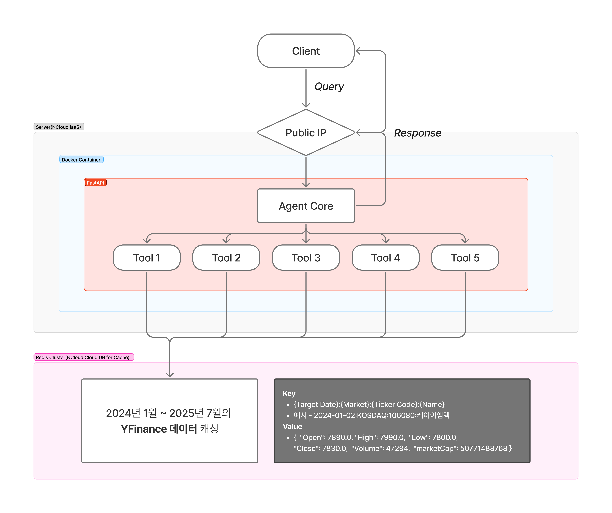
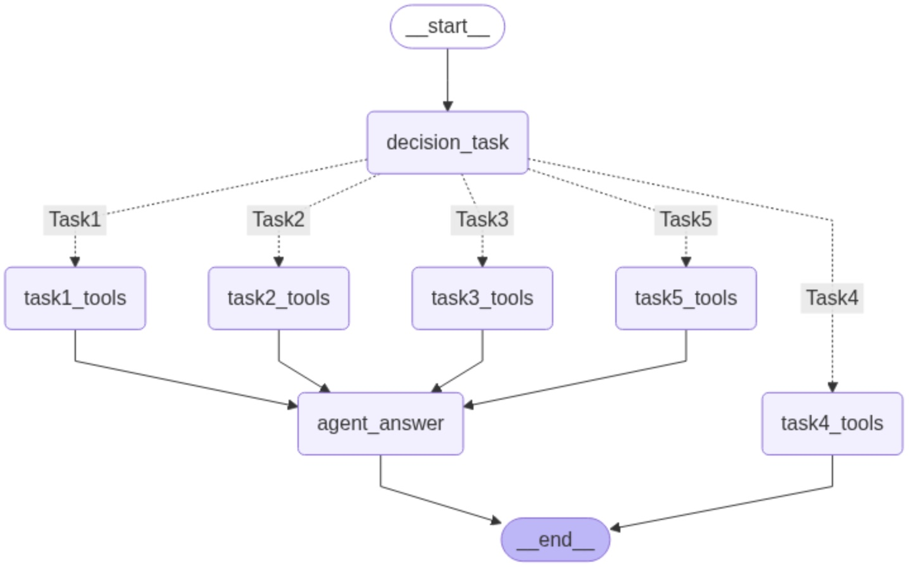

<p align="center">
  

<div align=center>
  
**FIN문철**은 투자대법관으로서 정확한 주식 정보 조회와 <br>
투자 판단 지표를 제공하여 사용자의 투자 의사결정을 지원합니다.

나 투자 판단 잘 한걸까? 금융 문해력을 키워주는 주식 비서 Agent

단순한 주가 조회를 넘어서 <br>
(1) 재무건전성과 (2) 기업업성장성을 종합적으로 평가하여 <br>
"이 종목 지금 사도 될까?"라는 투자자들의 근본적 질문에 전문가 수준의 답변을 제공합니다. <br>

```plaintext
최종 출력 예시:
[Fin문철 종합 리포트] 📈 종목: 삼성전자 (005930.KS) 📅 기준일: 2025-01-31

🔍 재무 건전성 진단 요약:
- 유동성: 우수 (유동비율 180%, 당좌비율 85%)
- 레버리지: 매우우수 (부채비율 95%, 이자보상배율 12배)
- 수익성: 보통 (ROE 8.2%, 영업이익률 7.5%)

🚀 시장 지표 기반 성장성 분석:
- PER 15.2배 (업계 평균 18.5배 대비 저평가)
- PBR 1.8배 (장부가 대비 적정)
- 애널리스트 목표가: 72,000원 (현재가 대비 +8.5%)

📌 AI 종합 판단 요약:
재무구조가 안정적이고 현재 저평가 구간에 위치하여 중장기 투자관점에서 
분할 매수를 권고합니다.
```
</div>

## 🏆 Competition
**제 9회 미래에셋증권 AI Festival**


## 🗓️ Timeline
2025.06.25 ~ 2025.07.31


## 👪 Team
**이하윤** ([hayo0n](https://github.com/hayo0n)) · **김이정** ([shashamalone](https://github.com/shashamalone)) · **윤왕규** ([yoonwanggyu](https://github.com/yoonwanggyu)) 


## 📚 Project Structure
```plaintext
📦 프로젝트 루트
├── 📂 data/                              # 데이터 저장 디렉토리
│   └── 📄 krx_tickers_with_market.csv    # 한국거래소 종목 코드 및 시장 정보
├── 📂 langgraph/                         # LangGraph 기반 AI 에이전트 모듈
│   ├── 📄 agent_core.py                  # 에이전트 핵심 로직 및 워크플로우
│   ├── 📄 nodes.py                       # 그래프 노드 정의 (각 처리 단계)
│   └── 📄 state.py                       # 에이전트 상태 관리 및 데이터 구조
├── 📂 tools/                             # 작업별 도구 모음
│   ├── 📄 task1_tools.py                 # 1단계 작업용 도구들
│   ├── 📄 task2_tools.py                 # 2단계 작업용 도구들
│   └── 📄 task3_tools.py                 # 3단계 작업용 도구들
├── 📄 .gitignore                         # 제외 파일 목록
├── 📄 Dockerfile                         # Docker 컨테이너 빌드 설정
├── 📄 data_fetcher.py                    # Redis 데이터 수집 및 처리
├── 📄 main.py                            # 메인 실행 파일
├── 📄 prompt.py                          # AI 프롬프트 템플릿 관리
├── 📄 redis_connector.py                 # Redis 캐시 연결 및 관리
├── 📄 utils.py                           # 공통 유틸리티 함수들
├── 📄 upload_to_redis.py                 # Redis 데이터 업로드 스크립트
└── 📄 requirements.txt                   # Python 패키지 의존성 목록
```

## ⚙️ System Architecture
<p align="center">
  

## ⚒️ Tech Stack Overview
- 🧠 **LLM : HyperClova X**<br>
  네이버의 대규모 언어모델로, 한국어에 특화된 고성능 AI 서비스를 제공합니다.<br>
  → 투자 관련 질의응답, 주식 분석, 금융 데이터 해석 등 전문적인 투자 상담 서비스의 핵심 엔진으로 활용

- 🔄 **LangGraph** <br>
  상태 기반 LLM 프레임워크로, 복잡한 에이전트 워크플로우를 유연하게 설계할 수 있습니다.<br>
  → Agentic RAG 흐름(Task 분기 → Tool 호출 -> 답변 생성)을 구현<br>

- ⚡ **NCloud Cloud DB for Cache(Redis Cluster)** <br>
  고성능 인메모리 데이터 스토어로, 캐싱과 세션 관리를 담당합니다. <br>
  → yfinance 데이터 (2024.01 ~ 2025.07) 데이터 적재 <br>
  → 발전 방향:
    - 대화 세션 관리를 통한 메모리 캐싱
    - 배치 컨테이너 구축 및 데이터 TTL 설정으로, 최근 주식 데이터를 주기적으로 업데이트

- 🏦 **Yahoo Finance API** <br>
  Yahoo Finance의 공개 API를 활용한 Python 라이브러리로, 실시간 및 과거 주식 데이터를 제공합니다. <br>
  → Redis에 캐싱된 데이터가 없을 경우 yfinance API를 호출하여 데이터 로드 <br>

- 🚀 **FastAPI**<br>
Python ASGI 웹 프레임워크 – 타입 힌트 기반 자동 문서화 & 고성능 비동기 처리를 지원합니다.<br>
→ /agent · /health 엔드포인트 구현, CORS 미들웨어·lifespan 훅으로 Redis 연결·해제 자동 관리

- ☁️ **NCloud IaaS (Ubuntu VM)**<br>
네이버클라우드 VPC 환경의 가상머신: Public Subnet(공인 IP) + Private Subnet(Redis Cluster) 구성되어 있습니다.<br>
→ 애플리케이션 서버(uvicorn) 를 IaaS 인스턴스에 배포, VPC 내부에서 Redis Cluster 접속

- 🐳 **Docker** <br>
  컨테이너화를 통한 일관된 개발 및 배포 환경을 제공합니다.<br>
  → 애플리케이션과 Redis를 컨테이너로 구성하여 환경 독립성과 배포 편의성 확보 <br>


## 🗺️ LangGraph Execution Flow
<p align="center">
  
</p>


## 🔄 Flow Details
🎯 **Decision Task**
- 목적: 사용자 질문을 적절한 Task로 분류
- 구현: [ROLE] → [TASK_DEFINITIONS] → [FEW_SHOT_EXAMPLES] → [USER_QUESTION]<br>
```bash
# ROLE
당신은 주식 정보 시스템을 위한 작업 분류 도우미입니다.
다른 말은 절대 출력하지 말고, 답변은 반드시 Task1·Task2·Task3·Task4 중 하나만 출력하세요.
 ```
```bash
# TASK DEFINITIONS
당신의 임무는 사용자의 질문을 다음 네 가지 작업(Task) 중 하나로 분류하는 것입니다:
- Task 1: 한국 주식시장(KOSPI/KOSDAQ)의 특정 날짜별 주가, 지수, 거래량, 랭킹 등 과거 금융 데이터 조회
- Task 2: 단순한 수치 조건 (등락률 ±N%, 거래량 전날대비 N% 등)
- Task 3: 기술적 분석 지표와 매매 신호 (RSI, 이동평균, 볼린저밴드 등)
- Task 4: 구체적인 기준이나 조건이 명시되지 않아서 해석이 필요한 질문
 ```
```bash
# FEW SHOT EXAMPLES
아래 정의를 참고하여 분류하세요:
Task 1:
  - "2024-07-22 KOSPI 지수는?"
  - "대한방직의 2025-04-25 종가는?"

Task 2 :
  - "2025-05-27에 등락률이 +20% 이상인 종목을 모두 보여줘"
  - "2025-05-21에 거래량이 1000만주 이상인 종목을 모두 보여줘"

Task 3:
  - "2025-03-06에 RSI가 20 이하인 과매도 종목을 알려줘"
  - "2024-08-22에 거래량이 20일 평균 대비 500% 이상 급증한 종목을 알려줘"

Task 4 :
  - "최근 많이 오른 주식"
  - "고점 대비 가장 많이 떨어진 종목"
 ```

⚙️ **Task1 ~ Task3**
- 목적: HyperClova X가 사용자 질문을 분석하여 적합한 도구를 자동 선택 및 실행<br>
- 구현: Langchain Tool 데코레이터를 HyperClova X와 결합<br>
```bash
# 대표 예시
@tool("answer_stock_query", description="특정 날짜에 특정 종목의 종가, 시가, 고가, 저가, 등락률 계산")
def answer_stock_query(stock: str, target_date: str, field: str):
    """
    특정 종목(stock)의 특정 날짜(target_date)의 Open/Close/Low/High/change_rate(field)를 반환합니다.

    Args:
        stock (str): 종목명, 예시 '한양증권'
        target_date (str): 날짜, 예시 '2025-03-12' (YYYY-MM-DD 형식)
        field (str): 조회할 항목. 아래 값 중 하나여야 합니다.
            - "Open"  : 시가
            - "High"  : 고가
            - "Low"   : 저가
            - "Close" : 종가
            - "change_rate" : 등락률(전일 종가 대비 등락률, %)
            - "Volumne" : 거래량

    Returns:
        str: 해당 날짜와 필드에 대한 값. 예를 들어,
            - "[2025-03-12] 종가: 13,800원"
            - "[2025-03-12] 시가: 14,000원"
            - "[2025-03-12] 등락률: -1.65%"

    예시 질문:
    - "KOSPI에서 롯데지주의 2024-07-05 종가는?"
    - "삼영엠텍의 2025-05-15 등락률은?"
    - "한네트의 2024-11-20 시가는?"
    - "도화엔지니어링의 2025-06-25 고가는?"
    """

# 각 Task별 Tools List
Task1_Tools = [answer_stock_query, answer_market_index,answer_market_ranking,answer_stock_compare,answer_market_stock_compare,answer_market_ratio,answer_market_compare]
Task2_Tools = [answer_task2]
Task3_Tools = [rsi, detect_cross, price_vs_adj_ma, bollinger_bands, get_high_volume_stocks]

```
⚙️ **Task 4** – 모호한 질문 정량화 및 재질의
- 목적: “최근 많이 오른 종목”, “고점 대비 하락한 주식” 등 모호한 표현을 정량화하거나, 되묻기로 명확한 조건을 받아 신뢰도 있는 답변 생성
- 구현: 프롬프트 기반으로 질문 속 모호어(예: ‘최근’, ‘많이’)를 감지<br>
  - 기준이 없으면 기간/퍼센트 등 선택지 제시
  - 기준이 명확할 경우 상위 10개 종목 + 수치로 정량 응답
```bash
- 대표 프롬프트: TASK4_FINAL_PROMPT
(예시 질문: “최근 많이 오른 주식 뭐야?” → “최근은 보통 30일 기준으로 판단합니다. ... 더 궁금하신가요?”)

Tool 목록:
Task5_Tools = [TASK5_FINAL_PROMPT]
```

⚙️ **Task 5** – 투자 판단 진단 및 종합 분석
- 목적: 사용자의 질문(예: "지금 사도 될까?", "내가 산 게 잘한 판단이야?")을 분석하여, 기업의 재무 건전성, 밸류에이션, 애널리스트 의견, 최근 리스크 이슈 등을 종합 평가하고 AI 종합 판결문 형식으로 응답
- 구현:
  - 종목명 추출 → 티커/기업코드 매핑
  - yFinance와 DART API에서 데이터 수집
  - LangChain Tool을 통해 LLM 기반 종합 프롬프트 생성 및 판결문 출력
```markdown
1. 종목 추출 및 티커 매핑
    - `get_info_stock()` 함수는 자연어에서 종목명을 추출하고 티커를 반환

2. 정량 기업 성장성 분석 (yfinance)
    -  `get_yfinance_data()`로 Yahoo Finance API를 통해 기업의 시세, 재무제표, 애널리스트 의견, 뉴스 등을 수집, PER, PBR, 현재가, 목표가, 추천 등을 가져옴

3. 공시정보 기반 리스크 분석 (DART)
    -  `get_dart_disclosure_data()`에서 DART 전자공시시스템에서 기업의 재무제표, 감사보고서, 공시 정보 등을 수집

4. LLM 프롬프트 구성 및 호출
    - 성장성 분석은 `format_growth_prompt()`로, 리스크 분석은 `format_growth_prompt()`로 분석 프롬프트를 만들고,
    `generate_investment_prompt_summary()`에서 최종 "FIN문철" 판결문 분석 결과를 받아옴

5. 최종 반환 포맷
-  자연어로 “현재 저평가인가?”, “리스크는 있는가?”, “지금 사도 되는가?”를 평가하고 “Fin문철 판결문”으로 마무리
- 즉, 단순히 주식정보를 통해 기업을 판단하는 것이 아닌 "성장성 + 건전성 + 리스크" 등을 결합한 통합적 기업 분석 구조
```


## 🚀 API 사용법
**1️⃣ 서버 기동**
```bash
docker build -t agent-m .
docker rm -f agent-m
docker run -d -p 8000:8000 --env-file .env --name agent-m agent-m
```
**2️⃣ 헬스 체크**
```bash
curl http://49.50.128.78:8000/health
```
상태 반환 확인
```
{"status":"ok"}
```

**3️⃣ 질문 호출**
```bash
curl -G --data-urlencode "question=2025-02-25에 RSI가 30 이하인 종목은?" \ 
  http://49.50.128.78:8000/agent \
  -H "Authorization: Bearer $NCP_CLOVASTUDIO_API_KEY" \
  -H "X-NCP-CLOVASTUDIO-REQUEST-ID: req-001"
```
